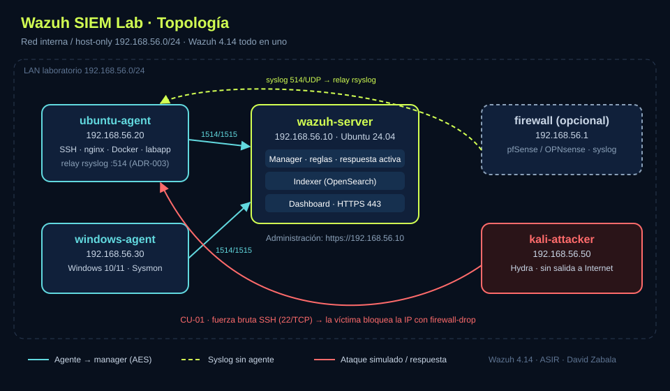

# 🛡️ Wazuh SIEM Lab — Centralización de logs, detección y respuesta

> Proyecto de **Administración de Sistemas Informáticos en Red (ASIR)** — David Zabala
> Laboratorio SIEM con **Wazuh 4.14.x** que centraliza logs de Linux, Windows y red, detecta ataques reales y responde de forma automática.

    

**English summary:** Home-lab SIEM built with Wazuh 4.14 (all-in-one). It centralizes Linux, Windows (Sysmon) and syslog sources through agent groups. It also includes custom decoders and rules, plus five detection scenarios: SSH brute force with active response, FIM, VirusTotal malware removal, Docker monitoring and vulnerability detection. Each scenario is mapped to MITRE ATT&CK and documented SOC-style.

---

## 🎯 Objetivos

- Desplegar un SIEM funcional con Wazuh en un laboratorio virtualizado.
- **Centralizar** la recogida de logs mediante grupos de agentes y `agent.conf` compartido.
- Detectar ataques reales y mapearlos a **MITRE ATT&CK**.
- Automatizar la **respuesta activa**, por ejemplo bloquear la IP de un atacante.
- Documentar cada caso como lo haría un **analista SOC**: evidencia, regla e informe de incidente.

## 🗺️ Arquitectura



Más detalle en [docs/01-arquitectura.md](docs/01-arquitectura.md).

| VM | Función | Recursos |
|---|---|---|
| wazuh-server | Wazuh 4.14 todo en uno | 4 vCPU · 8 GB · 50 GB |
| ubuntu-agent | Víctima SSH, nginx, Docker | 1-2 vCPU · 2 GB |
| windows-agent | Agente Windows + Sysmon | 2 vCPU · 4 GB |
| kali-attacker | Atacante (red aislada) | 1 vCPU · 2 GB |

## 📚 Documentación

| # | Documento | Contenido |
|---|---|---|
| 1 | [Arquitectura](docs/01-arquitectura.md) | Componentes, red, puertos |
| 2 | [Instalación](docs/02-instalacion.md) | Servidor todo en uno, contraseñas, repositorio |
| 3 | [Agentes y fuentes de logs](docs/03-agentes-y-logs.md) | Grupos, `agent.conf`, Sysmon, syslog, retención |
| 4 | [Casos de uso](docs/04-casos-de-uso.md) | 5 escenarios con evidencias |
| 5 | [Reglas personalizadas](docs/05-reglas-personalizadas.md) | Decoder + reglas + `wazuh-logtest` |
| 6 | [Troubleshooting](docs/06-troubleshooting.md) | Registro de problemas y soluciones |
| 7 | [Informe de incidente](docs/07-informe-incidente.md) | Plantilla estilo SOC |
| 8 | [Conclusiones y mejoras](docs/08-conclusiones.md) | Lecciones aprendidas, trabajo futuro |
| 9 | [Guion de la demo](docs/09-guion-demo.md) | Demo de 15 min y preguntas del tribunal |
| — | [Checklist de evidencias](evidencias/README.md) | Capturas y alertas que hay que guardar |
| — | [Decisiones de arquitectura (ADR)](docs/adr/README.md) | Versión, despliegue, ingesta de syslog |

## 🧪 Casos de uso

| Escenario | Disparador | Regla(s) | MITRE | Estado |
|---|---|---|---|---|
| Fuerza bruta SSH + bloqueo | `hydra` contra ubuntu-agent | 5551, 5712 → AR sobre 5763 | T1110 | ⬜ |
| Integridad de ficheros (FIM) | Crear o modificar un fichero monitorizado | 554, 550 | T1565 * | ⬜ |
| Malware (VirusTotal) + borrado | Fichero de prueba EICAR | 100200 / 100201 | T1204 * | ⬜ |
| Monitorización Docker | `docker run/stop/pause` | 87903-87906 * | — | ⬜ |
| Vulnerabilidades | Paquetes desactualizados | Módulo Vulnerability Detection | — | ⬜ |

\* Hay que confirmar los IDs y las técnicas con las alertas reales del laboratorio (campo `rule.id` / `rule.mitre.id`).

## 📁 Estructura del repositorio

```
wazuh-siem-lab/
├── docs/                 # Memoria del proyecto por capítulos
├── configs/
│   ├── manager/          # Fragmentos de ossec.conf, reglas y decoders
│   ├── shared/           # agent.conf por grupo (linux, windows)
│   ├── integrations/     # Script de notificaciones en Telegram
│   └── relay/            # rsyslog para los logs del firewall
├── scripts/              # Instalación, grupos y pruebas
├── diagramas/            # Diagramas de red (draw.io / PNG)
└── evidencias/           # Capturas y JSON de alertas
```

## ⚡ Inicio rápido

```bash
# En wazuh-server (Ubuntu 24.04, IP estática)
sudo bash scripts/01-install-server.sh
sudo bash scripts/02-create-groups.sh
```

Después despliega los agentes desde el dashboard: **Agents → Deploy new agent**.

## 🎓 Encaje con ASIR

| Escenario | Módulo / Resultado de aprendizaje |
|---|---|
| Fuerza bruta + respuesta activa | SAD — sistemas de detección de intrusos, cortafuegos |
| FIM y VirusTotal | SAD — detección y eliminación de malware |
| Syslog de cortafuegos | SAD — revisión de registros del cortafuegos |
| Informe de incidente | SAD — fases del análisis forense |
| Despliegue y agentes | ASO / Implantación de SO — administración de servicios |

> Hay que cotejar los RA con la programación del centro.

## ⚠️ Aviso

Laboratorio aislado y con fines educativos. Los ataques se ejecutan **solo** contra máquinas propias. No se usa malware real: solo el fichero de prueba EICAR.

## 📄 Licencia

[Mozilla Public License 2.0](LICENSE)
