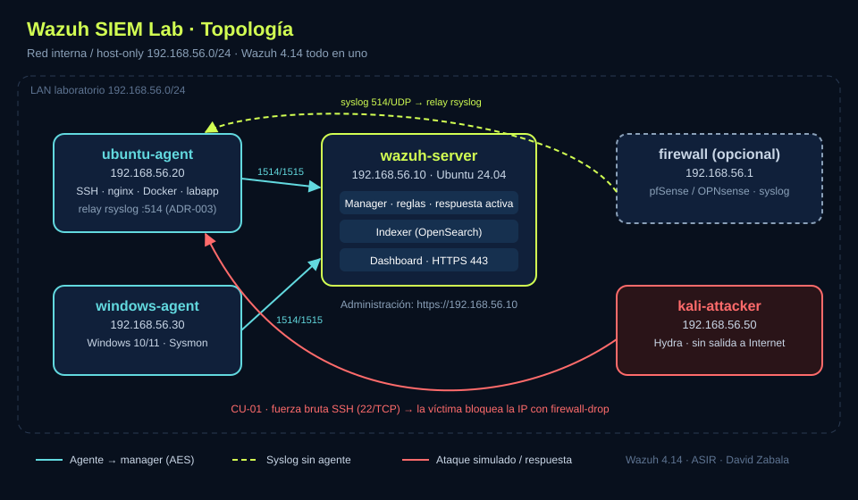

# 1. Arquitectura

## Componentes de Wazuh

| Componente | Función |
|---|---|
| **Agente** | Recoge logs, integridad de ficheros, inventario y eventos de cada endpoint |
| **Servidor (manager)** | Decodifica los eventos, los compara con las reglas y lanza la respuesta activa |
| **Indexer** (OpenSearch) | Almacena e indexa alertas y eventos |
| **Dashboard** | Interfaz web de análisis y gestión |

En la versión 4.14, **Filebeat** envía las alertas del manager al indexer. Los dispositivos sin agente (firewalls, switches) se integran por **syslog**.

## Red del laboratorio

- **Red interna / host-only:** `192.168.56.0/24` (ajústala a tu hipervisor).
- La máquina atacante **no** tiene salida a Internet durante las pruebas.

| Host | IP | SO | Rol |
|---|---|---|---|
| wazuh-server | 192.168.56.10 | Ubuntu Server 24.04 | Manager + indexer + dashboard |
| ubuntu-agent | 192.168.56.20 | Ubuntu Server 24.04 | Víctima SSH, nginx, Docker |
| windows-agent | 192.168.56.30 | Windows 10/11 | Agente + Sysmon |
| kali-attacker | 192.168.56.50 | Kali Linux | Atacante |
| firewall (opcional) | 192.168.56.1 | pfSense / OPNsense | Envío de syslog |

## Puertos

| Puerto | Protocolo | Uso | ¿Abrir en la red? |
|---|---|---|---|
| 443 | TCP | Dashboard web | ✅ |
| 1514 | TCP | Comunicación agente → manager (AES) | ✅ |
| 1515 | TCP | Enrolamiento de agentes | ✅ |
| 514 | UDP | Syslog de dispositivos de red | ✅ (si se usa) |
| 55000 | TCP | API del manager | Solo local |
| 9200 | TCP | API del indexer | Solo local |

## Diagrama

